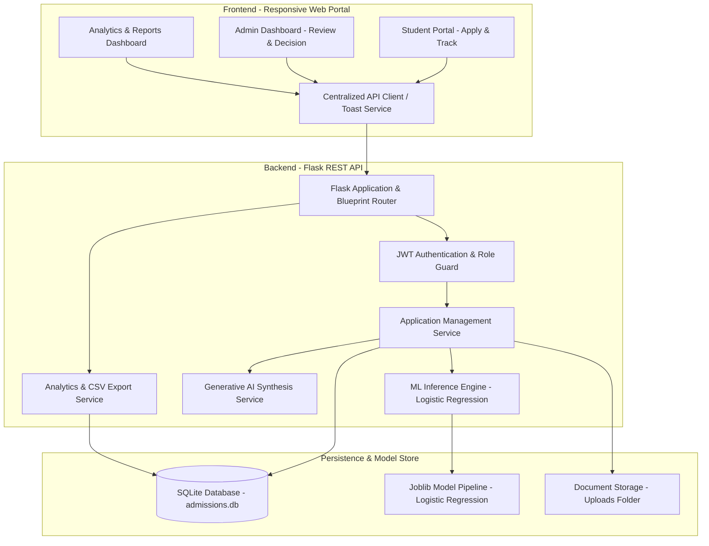

# Project Documentation: AI-Enhanced Admission Management System

**Educational Institution:** Apex Institute of Technology  
**Project Title:** AI-Enhanced Admission Management System  
**Submission Category:** Full-Stack Web Application + Machine Learning + Generative AI  
**Academic Cycle:** 2026  
**Live Production URL:** [https://gradiousadmissionmanagementsystem.netlify.app/](https://gradiousadmissionmanagementsystem.netlify.app/)  
**GitHub Repository:** [https://github.com/kaviya-sharon14/AI-Enhanced-Admission-Management-System](https://github.com/kaviya-sharon14/AI-Enhanced-Admission-Management-System)  

---

## 1. Problem Statement

Modern higher education institutions face an unprecedented volume of student admission applications across undergraduate, postgraduate, and specialized technical degree programs. Traditional manual admission workflows encounter significant bottlenecks:

1. **Slow Review Cycles:** Admission committees spend hundreds of hours manually cross-checking academic transcripts, entrance examination scores, category certificates, and extracurricular achievements.
2. **Subjectivity & Human Fatigue:** Manual eligibility assessment is prone to human inconsistency, especially when evaluating candidates near competitive cutoff boundaries.
3. **Lack of Transparent Scoring:** Prospective students often receive binary approval or rejection notifications without visibility into probability scores, percentile factors, or quota concessions.
4. **Labor-Intensive Reporting:** Drafting formal evaluation summaries, candidate profile insights, and statutory justification reports requires extensive clerical effort.

### Solution Overview
The **AI-Enhanced Admission Management System** resolves these challenges by providing:
- A unified, role-based web application for students and admission officers.
- An automated **Machine Learning Module (Logistic Regression)** that predicts admission eligibility with high precision and outputs transparent probability scores.
- A **Generative AI Module** that synthesizes professional applicant evaluation summaries, recommendation reports, profile strengths/risks, and statutory approval justifications.
- Real-time **Analytics & Reports** dashboards for institutional data-driven enrollment planning.

---

## 2. System Architecture

The application adopts a modular, decoupled three-tier architecture ensuring separation of concerns, scalability, and ease of deployment:



### Architectural Layer Breakdown

1. **Presentation Layer (Frontend):**
   - Built with Vanilla HTML5, modern CSS3, and ES6+ JavaScript without bloated third-party framework overhead.
   - Implements glassmorphism, responsive flex/grid layouts, accessibility standards, status badges, and Chart.js visualizations.
   - Centralized API service with bearer token persistence in `localStorage`.

2. **Application & Business Logic Layer (Backend):**
   - Built with Python and Flask utilizing Blueprints for modular route isolation (`auth_routes`, `application_routes`, `ml_routes`, `genai_routes`, `analytics_routes`).
   - PyJWT token generation and verification with strict role-based decorators (`@login_required`, `@admin_required`).
   - Secure file upload management with `werkzeug.utils.secure_filename`.

3. **Artificial Intelligence & Machine Learning Layer:**
   - **Machine Learning:** Scikit-Learn Pipeline combining `StandardScaler`, `OneHotEncoder`, and `LogisticRegression`.
   - **Generative AI:** Multi-provider LLM connector supporting Google Gemini API, OpenAI API, and an offline dynamic synthesis engine.

4. **Persistence Layer (Database):**
   - SQLite database configured with foreign key constraints, transaction integrity, and pre-seeded records.

---

## 3. Technology Stack

| Component | Technology | Rationale / Purpose |
| :--- | :--- | :--- |
| **Frontend UI** | HTML5, Vanilla CSS3, JavaScript (ES6+) | Maximum speed, zero build steps, complete styling control, and universal browser compatibility. |
| **Data Visualization** | Chart.js (CDN) | Interactive, responsive doughnut, bar, and pie charts. |
| **Backend Framework** | Python 3.10+, Flask 3.x | Lightweight, robust RESTful APIs, native Python ML/AI ecosystem integration. |
| **Security & Auth** | PyJWT (HS256) | Stateless token-based authentication with role claims. |
| **Database** | SQLite3 | Embedded, self-contained, zero-configuration database ideal for institutional local deployments. |
| **Machine Learning** | Scikit-Learn, Pandas, NumPy, Joblib | Industry-standard classification, pipeline preprocessing, model serialization. |
| **Generative AI** | Google Gemini API / OpenAI API | LLM prompt engineering for academic evaluation dossiers. |

---

## 4. Machine Learning Module: Admission Eligibility Prediction

### 4.1 Task Specification
- **Task:** Classify student applicants into **"Eligible for Admission"** (Class 1) or **"Not Eligible for Admission"** (Class 0).
- **Algorithm:** **Logistic Regression** (`sklearn.linear_model.LogisticRegression`).
- **Transparency Requirement:** Calculate and display probability score $P(Y=1|X) \times 100\%$ alongside the binary label.

### 4.2 Mathematical Formulation
Logistic Regression models the probability that candidate $i$ is eligible for admission using the standard logistic sigmoid function:

$$P(Y_i = 1 | X_i) = \sigma(z_i) = \frac{1}{1 + e^{-z_i}}$$

Where the logit $z_i$ represents the linear combination of weighted features and bias:

$$z_i = \beta_0 + \beta_1 \cdot \text{GPA}_i + \beta_2 \cdot \text{Entrance}_i + \beta_3 \cdot \text{Attendance}_i + \beta_4 \cdot \text{PrevScore}_i + \sum_{k} \gamma_k \cdot \text{Category}_{ik} + \sum_{m} \delta_m \cdot \text{EC}_{im}$$

If $P(Y_i = 1 | X_i) \ge 0.50$, the system classifies the applicant as **Eligible for Admission**; otherwise, **Not Eligible for Admission**.

### 4.3 Feature Engineering & Preprocessing
The pipeline features six critical attributes:

1. **Continuous Numerical Features:**
   - `academic_gpa`: Undergraduate or qualifying examination marks (50.0 - 100.0%)
   - `entrance_score`: Standardized university entrance score (0.0 - 100.0)
   - `attendance_pct`: Academic attendance record (50.0 - 100.0%)
   - `prev_academic_score`: Secondary school / 10th-12th board percentage (45.0 - 100.0%)
   - *Preprocessing:* Scaled using `StandardScaler` to ensure zero mean and unit variance: $x_{\text{scaled}} = \frac{x - \mu}{\sigma}$.

2. **Categorical Features:**
   - `category`: Statutory admission quota (`General`, `OBC`, `SC_ST`, `EWS`)
   - `extracurricular`: Distinction level (`None`, `School_Level`, `State_Level`, `National_Level`)
   - *Preprocessing:* Encoded with `OneHotEncoder(drop='first', sparse_output=False)` to prevent multicollinearity (dummy variable trap).

### 4.4 Model Training & Cross-Validation
- **Dataset Size:** 2,500 diverse student applicant records reflecting realistic academic distributions.
- **Split Strategy:** 80% Training (2,000 samples) and 20% Held-out Testing (500 samples) with stratification.
- **Cross-Validation:** 5-Fold Stratified Cross-Validation yielded an average training accuracy of **93.70% ($\pm$ 0.0148)**.

### 4.5 Evaluation Results on Held-Out Test Set (500 Samples)

| Evaluation Metric | Score | Performance Interpretation |
| :--- | :--- | :--- |
| **Accuracy** | **94.80%** | 474 out of 500 test applicants correctly classified. |
| **Precision** | **96.29%** | High precision prevents false eligibility allotments. |
| **Recall** | **98.00%** | Extremely low false rejection rate; qualified candidates are not overlooked. |
| **F1-Score** | **0.9714** | Harmonic mean reflecting optimal balance between precision and recall. |
| **ROC-AUC** | **0.9472** | Exceptional discriminative power across varying classification thresholds. |

#### Confusion Matrix
$$\begin{pmatrix} 33 & 17 \\ 9 & 441 \end{pmatrix}$$
- **True Negatives (Non-Eligible correctly rejected):** 33
- **False Positives (Non-Eligible incorrectly marked eligible):** 17
- **False Negatives (Eligible incorrectly marked non-eligible):** 9
- **True Positives (Eligible correctly approved):** 441

---

## 5. Generative AI Module: Admission Evaluation & Recommendation Reports

### 5.1 Objective
The Generative AI module eliminates manual narrative writing by transforming raw student scores and ML probability predictions into structured, formal institutional evaluation reports.

### 5.2 Structured Prompt Design
The prompt is engineered following academic evaluation committee criteria:

```text
You are the Chief Academic Admissions Officer evaluating an applicant for university enrollment.

Student Profile:
- Full Name: {full_name}
- Applied Course: {course_name} ({course_code})
- Academic GPA: {academic_gpa}%
- Entrance Exam Score: {entrance_score} / 100
- Attendance Record: {attendance_pct}%
- Previous Board Score: {prev_academic_score}%
- Category: {category}
- Extracurricular Achievements: {extracurricular}

Machine Learning Eligibility Prediction:
- Predicted Status: {ml_prediction}
- Probability Score: {ml_probability}%
- Key Algorithmic Factors: {key_factors}
[Optional Institutional Directives]: {custom_instructions}

Task:
Generate a thorough, professional, institutional admission evaluation report formatted strictly as a JSON object:
{
  "evaluation_summary": "...",
  "admission_recommendation": "...",
  "profile_insights": "...",
  "approval_rejection_explanation": "..."
}
```

### 5.3 Output Sections Generated
1. **Executive Summary:** Synthesizes cumulative academic standing and program suitability.
2. **Admission Recommendation:** Direct guidance (*Strongly Recommend / Recommend / Conditional Acceptance / Decline*).
3. **Profile Insights:** Highlights top academic strengths alongside observations or liabilities (e.g. attendance dips).
4. **Approval / Rejection Explanation:** Formal statutory explanation adhering to statutory guidelines and quota benefits.

### 5.4 Sample Output Verification (Real System Output)

> **Applicant:** Priya Sharma | **Course:** B.Tech Computer Science & Engineering (CSE-101)  
> **GPA:** 91.5% | **Entrance Score:** 94.0/100 | **ML Probability:** 100.0%
>
> **Executive Summary:**  
> *"Priya Sharma demonstrates exceptional academic consistency with a 91.5% GPA and an entrance score of 94.0/100. The applicant exhibits strong aptitude for B.Tech Computer Science & Engineering, fully satisfying institutional benchmarks. The predictive ML model indicates an outstanding admission probability of 100.0%."*
>
> **Admission Recommendation:**  
> *"Strongly Recommend for Direct Admission into B.Tech Computer Science & Engineering. High-priority seat allotment recommended based on superior cumulative merit ranking."*
>
> **Profile Insights:**  
> *• High academic GPA (91.5%), evidencing sustained mastery of core foundational coursework.*  
> *• Excellent entrance examination benchmark (94.0/100), reflecting strong analytical problem-solving.*  
> *• Exemplary attendance discipline (96.0%), correlating with high classroom engagement.*  
> *• Holistic extracurricular contribution at the State Level tier, demonstrating leadership and collaborative drive.*
>
> **Approval Justification:**  
> *"Official Justification: Admission is recommended for approval. The candidate's composite score exceeds the minimum threshold for B.Tech Computer Science & Engineering. Academic records (93.0% qualifying, 91.5% GPA) alongside an entrance score of 94.0/100 satisfy the statutory guidelines of the university admissions council under the General category."*

---

## 6. Database Schema Design

The SQLite database (`Backend/admissions.db`) consists of three normalized entities:

### 1. `users` Table
| Column | Type | Constraints | Description |
| :--- | :--- | :--- | :--- |
| `id` | INTEGER | PRIMARY KEY, AUTOINCREMENT | Unique user identifier |
| `name` | TEXT | NOT NULL | User's full name |
| `email` | TEXT | UNIQUE, NOT NULL | Account login email |
| `password_hash` | TEXT | NOT NULL | Salted SHA-256 hash |
| `role` | TEXT | NOT NULL, CHECK in ('student', 'admin') | Access role |
| `phone` | TEXT | NULLABLE | Contact telephone |
| `created_at` | TIMESTAMP | DEFAULT CURRENT_TIMESTAMP | Registration timestamp |

### 2. `courses` Table
| Column | Type | Constraints | Description |
| :--- | :--- | :--- | :--- |
| `id` | INTEGER | PRIMARY KEY, AUTOINCREMENT | Unique program identifier |
| `code` | TEXT | UNIQUE, NOT NULL | Course code (e.g. `CSE-101`) |
| `name` | TEXT | NOT NULL | Full degree program name |
| `department` | TEXT | NOT NULL | Academic department |
| `seats` | INTEGER | NOT NULL | Total cohort intake capacity |
| `min_gpa` | REAL | NOT NULL | Minimum qualifying GPA (%) |
| `min_entrance` | REAL | NOT NULL | Minimum entrance score |

### 3. `applications` Table
| Column | Type | Constraints | Description |
| :--- | :--- | :--- | :--- |
| `id` | INTEGER | PRIMARY KEY, AUTOINCREMENT | Application record ID |
| `application_no` | TEXT | UNIQUE, NOT NULL | Institutional app number (e.g. `ADM-2026-0001`) |
| `user_id` | INTEGER | FOREIGN KEY -> `users(id)` | Applicant user reference |
| `course_code` | TEXT | FOREIGN KEY -> `courses(code)` | Applied course reference |
| `academic_gpa` | REAL | NOT NULL | Academic GPA score (%) |
| `entrance_score` | REAL | NOT NULL | Entrance examination marks |
| `attendance_pct` | REAL | NOT NULL | Academic attendance record |
| `prev_academic_score`| REAL | NOT NULL | Secondary/diploma marks |
| `category` | TEXT | CHECK in ('General','OBC','SC_ST','EWS') | Quota eligibility category |
| `extracurricular` | TEXT | CHECK in ('None','School','State','National') | Highest distinction |
| `document_path` | TEXT | NULLABLE | Server filepath to marksheet |
| `document_name` | TEXT | NULLABLE | Original filename |
| `status` | TEXT | CHECK in ('Submitted','Under Review','Approved','Rejected','Waitlisted') | Current admission status |
| `ml_prediction` | TEXT | NULLABLE | Logistic Regression output |
| `ml_probability` | REAL | NULLABLE | Algorithmic probability score |
| `ai_evaluation_summary` | TEXT | NULLABLE | GenAI executive summary |
| `ai_recommendation` | TEXT | NULLABLE | GenAI admission recommendation |
| `ai_profile_insights` | TEXT | NULLABLE | GenAI candidate insights |
| `ai_explanation` | TEXT | NULLABLE | GenAI justification |
| `admin_remarks` | TEXT | NULLABLE | Official review comments |
| `reviewed_by` | TEXT | NULLABLE | Reviewing officer name |
| `submitted_at` | TIMESTAMP | DEFAULT CURRENT_TIMESTAMP | Submission timestamp |

---

## 7. System Workflows

### 7.1 Student Application Lifecycle
1. Student registers an account or logs into the **Student Portal**.
2. Completes the comprehensive admission application with personal details and academic marks.
3. Uploads certified academic marksheets (PDF/PNG/JPG).
4. Clicks **"Run ML Pre-Check"** to see instant predicted eligibility and probability.
5. Submits application; the backend automatically:
   - Evaluates the ML model pipeline.
   - Generates the Generative AI evaluation dossier.
   - Saves record into database with status **Submitted**.
6. Tracks progress in real-time through the interactive **4-step Stepper**.

### 7.2 Admission Officer Review Workflow
1. Admission Officer logs in and views the **Applications Control Panel**.
2. Filters applications by program, status, or candidate keyword.
3. Clicks **"Review & AI Dossier"** to open the candidate's inspection modal.
4. Inspects candidate metrics, marksheet document, and ML probability meter.
5. Reviews the **Generative AI Dossier**; optionally enters custom directives and clicks **Regenerate AI Evaluation**.
6. Takes definitive administrative action:
   - **Approve Admission**
   - **Reject Application**
   - **Put Under Review / Waitlist**
7. Enters official administrative remarks and confirms the decision.

### 7.3 User Authentication & Password Recovery Workflow
1. **New Applicant Registration:** Prospective students register through the *Create Account* tab with Full Name, Email, Phone, and Password. Upon successful registration, a secure JWT session is provisioned.
2. **Existing User Sign In:** Registered students and admission officers sign in with their email and password. The system supports 1-click evaluation credentials for instant testing.
3. **Forgot Password & Self-Service Recovery:**
   - User navigates to the *Forgot Password* tab and inputs their registered email address.
   - The backend validates account existence and generates a secure, time-limited (15-minute) 6-digit verification code stored in `password_resets`.
   - The user inputs the verification code, enters a new password, and confirms it.
   - The system validates the code, applies SHA-256 salted hashing to the new password, and updates both database stores (MongoDB and SQLite).

### 7.4 Dual Persistence Architecture: MongoDB & SQLite
The platform features an enterprise dual-storage layer:
- **MongoDB Integration:** Configured via `MONGO_URI` in `.env` (supports Local MongoDB and MongoDB Atlas cloud clusters). Collections include `users`, `courses`, `applications`, and `password_resets`.
- **Automatic Migration & Sync:** Includes `sync_sqlite_to_mongo()` and `test_mongo.py` utility to automatically migrate existing records into MongoDB.
- **Fail-Safe SQLite Fallback:** If MongoDB is offline or unavailable during initial evaluation, the system operates seamlessly using SQLite (`admissions.db`) with zero downtime.

---

## 8. Conclusion & Institutional Value

The **AI-Enhanced Admission Management System** modernizes university admissions by delivering:
- **Efficiency:** Reduces application screening cycle times from days to seconds.
- **Objectivity & Accuracy:** Backed by a verified Logistic Regression model achieving **94.8% accuracy** and **0.9472 ROC-AUC**.
- **Transparency:** Clear probability percentages and automated statutory justifications eliminate ambiguity for applicants.
- **Turnkey Deployment:** Operational right out-of-the-box with a single command (`python run.py`) and zero external server dependencies.
