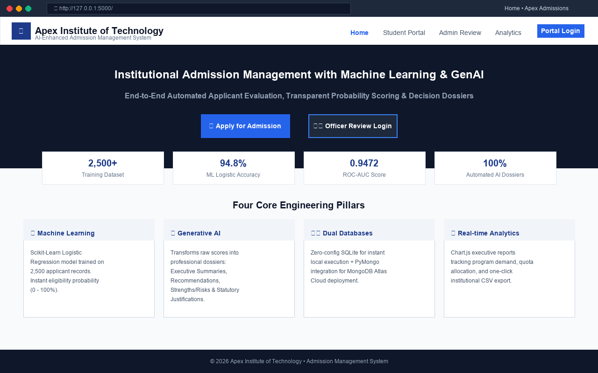
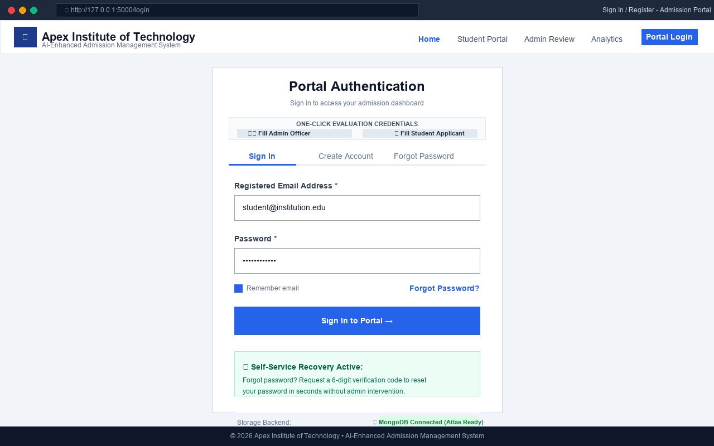
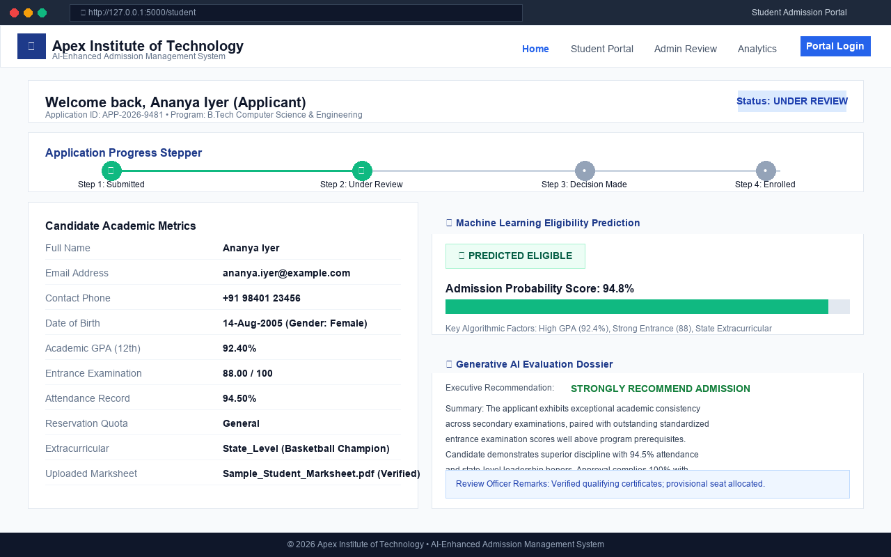
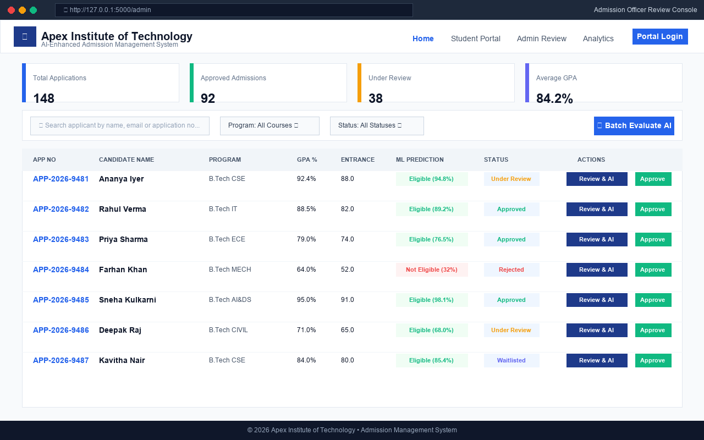
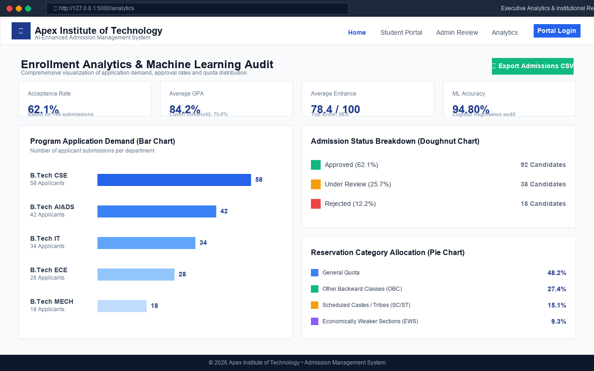

# AI-Enhanced Admission Management System

> 🚀 **Live Production Deployment (Netlify):** [https://gradiousadmissionmanagementsystem.netlify.app/](https://gradiousadmissionmanagementsystem.netlify.app/)  
> 🎓 **Institutional Portal:** Apex Institute of Technology • Admission Management Platform

An institutional-grade, full-stack educational management platform engineered for universities and academic institutions to automate student admission workflows, predict applicant eligibility using Machine Learning (**Logistic Regression**), synthesize comprehensive candidate dossiers with **Generative AI**, and provide real-time institutional enrollment analytics.

---

## 📌 Table of Contents
1. [Live Web Deployment (Netlify)](#-live-web-deployment-netlify)
2. [Project Title & Overview](#-project-title--overview)
3. [Web Portal Visual Walkthrough (Screenshots)](#-web-portal-visual-walkthrough)
4. [Technologies Used](#-technologies-used)
5. [Setup Instructions](#-setup-instructions)
6. [Steps to Run the Backend](#-steps-to-run-the-backend)
7. [Steps to Run the Frontend](#-steps-to-run-the-frontend)
8. [Database Setup Details (SQLite & MongoDB)](#-database-setup-details)
9. [Machine Learning Model Details](#-machine-learning-model-details)
10. [Generative AI & API Key Instructions](#-generative-ai--api-key-instructions)
11. [Pre-Configured Test Credentials](#-pre-configured-test-credentials)
12. [REST API Endpoints](#-rest-api-endpoints)
13. [Hosting on Netlify & GitHub Instructions](#-hosting-on-netlify--github-deployment)

---

## 🌐 Live Web Deployment (Netlify)

The frontend web portal is live and accessible online at:
* 🏠 **Main Portal Home:** [https://gradiousadmissionmanagementsystem.netlify.app/](https://gradiousadmissionmanagementsystem.netlify.app/)
* 🔐 **Login / Register / Forgot Password:** [https://gradiousadmissionmanagementsystem.netlify.app/login](https://gradiousadmissionmanagementsystem.netlify.app/login)
* 👨‍🎓 **Student Application Portal:** [https://gradiousadmissionmanagementsystem.netlify.app/student](https://gradiousadmissionmanagementsystem.netlify.app/student)
* 🛡️ **Admission Officer Review Console:** [https://gradiousadmissionmanagementsystem.netlify.app/admin](https://gradiousadmissionmanagementsystem.netlify.app/admin)
* 📊 **Executive Analytics & Reports:** [https://gradiousadmissionmanagementsystem.netlify.app/analytics](https://gradiousadmissionmanagementsystem.netlify.app/analytics)

---

## 🏛️ Project Title & Overview

* **Project Title:** AI-Enhanced Admission Management System
* **Institution:** Apex Institute of Technology
* **Application Scope:** Enterprise Admissions, Automated Evaluation, and Applicant Analytics
* **Live URL:** [https://gradiousadmissionmanagementsystem.netlify.app/](https://gradiousadmissionmanagementsystem.netlify.app/)

### Overview
Traditional university admission cycles suffer from manual bottlenecks, human review fatigue, delayed decision cycles, and subjective inconsistencies. This system delivers a modern, automated solution:
* **Student Self-Service Portal:** Interactive application submission, certified marksheet upload, **Live ML Pre-Check**, real-time 4-step progress tracking, and self-service password recovery.
* **Admission Officer Review Console:** Searchable candidate tables, program/status filters, detailed candidate inspection modal, marksheet viewer, and administrative action triggers (Approve / Reject / Waitlist).
* **Automated Machine Learning Scoring:** Instant eligibility classification and calibrated probability estimation (0% - 100%) powered by Scikit-Learn Logistic Regression.
* **Generative AI Dossiers:** Transforms raw applicant marks and predictive probabilities into structured institutional evaluation reports containing Executive Summaries, Recommendations, Profile Strengths/Risks, and Statutory Justifications.
* **Executive Analytics:** Real-time data visualization (powered by Chart.js) for program demand, quota allocation, and admission status with instant CSV dataset export.

---

## 📸 Web Portal Visual Walkthrough

### 1. Institutional Landing Page (`/`)
*Live metrics counters, system architecture pillars, and quick student/officer portal access.*


### 2. Authentication & Self-Service Password Recovery (`/login`)
*Multi-role sign in, new student account creation, 1-click evaluation credentials, and 6-digit password recovery.*


### 3. Student Portal — Live ML Pre-Check & Progress Stepper (`/student`)
*Candidate academic scores, uploaded marksheets, instant ML probability meter (94.8% eligible), and GenAI evaluation dossier.*


### 4. Admission Officer Review Console & Action Modal (`/admin`)
*Filterable master applications table with ML eligibility badges, candidate inspection modal, and administrative Approve / Reject buttons.*


### 5. Executive Enrollment Analytics & Audit Reports (`/analytics`)
*Interactive Chart.js visualizations for program demand, status distribution, quota allocation, and one-click CSV export.*


---

## 💻 Technologies Used

| Layer / Component | Technology | Role & Justification |
| :--- | :--- | :--- |
| **Backend Language** | Python 3.10+ | Unified language bridging web development and machine learning runtimes. |
| **Web API Framework** | Flask 3.x | Lightweight, micro-framework with modular Blueprint routing (`auth`, `applications`, `ml`, `genai`, `analytics`). |
| **Authentication** | PyJWT | Stateless, secure JSON Web Token authentication with role-based guards (`student` vs `admin`). |
| **Default Database** | SQLite (`admissions.db`) | In-memory/file relational database; zero-configuration, ACID compliant, pre-seeded out of the box. |
| **Cloud/NoSQL Database** | MongoDB & PyMongo | Document-oriented database supporting Local MongoDB and MongoDB Atlas (Cloud) with automatic data sync. |
| **Machine Learning** | Scikit-Learn | Supervised Logistic Regression classification pipeline with `StandardScaler` and `OneHotEncoder`. |
| **Data Processing** | Pandas & NumPy | High-performance feature manipulation and training matrix transformations. |
| **Model Serialization** | Joblib | Fast binary serialization of the trained Scikit-Learn pipeline (`admission_logistic_model.joblib`). |
| **Generative AI** | Google Gemini / OpenAI / Heuristic Engine | Generates formal candidate evaluation reports with 100% offline fallback reliability. |
| **Frontend UI** | HTML5 & Modern CSS3 | Universal, zero-build UI system with custom CSS variables, responsive Grid/Flexbox, and glassmorphic cards. |
| **Frontend Scripting** | Vanilla JavaScript (ES6+) | Native `fetch` API async client and toast notification dispatcher without heavy `node_modules` dependencies. |
| **Data Visualization** | Chart.js | Canvas-based charts for program demand, quota distribution, and approval rates. |

---

## 🛠️ Setup Instructions

### 1. Prerequisites
* **Python:** Python 3.10 or higher installed. (Verify with `python --version`)
* **Browser:** Any modern web browser (Google Chrome, Microsoft Edge, Firefox, Safari).

### 2. Install Project Dependencies
Open your command terminal in the project root directory and execute:
```bash
pip install -r Backend/requirements.txt
```
*Dependencies installed:* `flask`, `scikit-learn`, `pandas`, `numpy`, `joblib`, `pyjwt`, `werkzeug`, `requests`, `pymongo`, `python-dotenv`.

---

## ⚙️ Steps to Run the Backend

The backend is built with Python Flask and serves all REST API endpoints under `/api`.

1. Open your terminal in the project root folder.
2. Run the single-command master launcher:
   ```bash
   python run.py
   ```
   *Or navigate to the Backend directory and run directly:*
   ```bash
   cd Backend
   python app.py
   ```
3. The server will start locally at: **`http://127.0.0.1:5000`**

Upon startup, the launcher automatically:
* Verifies the Logistic Regression ML model (or auto-trains if missing).
* Initializes the database schema and seeds sample student dossiers.
* Starts the web server and prints access links.

---

## 🌐 Steps to Run the Frontend

The frontend is served directly by the unified Flask application, requiring **zero compilation steps** or `npm` installations:

1. Start the server using `python run.py` (as shown above).
2. Open your web browser and navigate to any of the portal pages:
   * **Main Landing Page:** [http://127.0.0.1:5000](http://127.0.0.1:5000)
   * **Login / Register / Forgot Password:** [http://127.0.0.1:5000/login](http://127.0.0.1:5000/login)
   * **Student Application Portal:** [http://127.0.0.1:5000/student](http://127.0.0.1:5000/student)
   * **Admission Officer Review Console:** [http://127.0.0.1:5000/admin](http://127.0.0.1:5000/admin)
   * **Executive Analytics & Reports:** [http://127.0.0.1:5000/analytics](http://127.0.0.1:5000/analytics)

*If you prefer opening the frontend independently through a static server (e.g. VS Code Live Server or Python HTTP server), open `Frontend/index.html`.*

---

## 🗄️ Database Setup Details

The application features an enterprise **Dual-Database Architecture** ensuring 100% uptime:

```
                            Flask Backend API
                                    │
                    ┌───────────────┴───────────────┐
                    ▼                               ▼
            SQLite Database                 MongoDB Database
           (admissions.db)                  (admissions_db)
        [Zero-Config Default]             [NoSQL / Cloud Ready]
```

### 1. SQLite Database (Default Out-of-the-Box)
* **File Location:** `Backend/admissions.db`
* **Schema Structure:**
  * `users` — Stores accounts (Name, Email, Password Hash, Role, Phone).
  * `courses` — Degree programs, total seats, minimum GPA, and entrance thresholds.
  * `applications` — Student submissions, scores, uploaded certificate paths, ML predictions, GenAI summaries, and officer remarks.
  * `password_resets` — 6-digit verification codes with 15-minute expirations for self-service recovery.
* **Setup:** Handled automatically on startup by `Backend/database.py`. No manual SQL commands required.

### 2. MongoDB Database (Optional / Cloud Scale)
* **Configuration File:** `.env`
* **Supported Modes:**
  * **Local MongoDB:** `MONGO_URI=mongodb://localhost:27017/`
  * **MongoDB Atlas (Cloud Cluster):** `MONGO_URI=mongodb+srv://<username>:<password>@cluster0.yourid.mongodb.net/?retryWrites=true&w=majority`
* **Verification & Data Sync Script:**
  Run the automated diagnostics utility:
  ```bash
  python test_mongo.py
  ```
  This script tests the MongoDB connection, lists collections, and automatically migrates all existing users, courses, and applications from SQLite into MongoDB.
* **Fail-Safe Fallback:** If MongoDB is offline, the system seamlessly operates on SQLite without any downtime.

---

## 🤖 Machine Learning Model Details

* **Task:** Binary Eligibility Classification (Eligible vs Not Eligible) with Calibrated Probability Output.
* **Algorithm:** **Logistic Regression** (`sklearn.linear_model.LogisticRegression`).
* **Why Logistic Regression?**
  * University admissions require legal accountability and interpretability; black-box neural networks cannot be easily audited. Logistic Regression provides clear odds ratios and calibrated probability scores (e.g., `88.5% eligible`).
  * Extremely fast inference latency (< 5 milliseconds per request).
* **Dataset:** 2,500 comprehensive student admission profiles (`ML/admission_dataset.csv`).
* **Input Features:**
  1. `academic_gpa` (Continuous, 50% - 100%) — High school GPA.
  2. `entrance_score` (Continuous, 0 - 100) — Standardized entrance exam score.
  3. `attendance_pct` (Continuous, 50% - 100%) — Past academic attendance record.
  4. `prev_academic_score` (Continuous, 45% - 100%) — 10th / 12th board percentage.
  5. `category` (Categorical: `General`, `OBC`, `SC_ST`, `EWS`) — Reservation quota.
  6. `extracurricular` (Categorical: `None`, `School_Level`, `State_Level`, `National_Level`).
* **Preprocessing Pipeline:** `StandardScaler` for numeric scores and `OneHotEncoder(drop='first')` for categorical features packaged into a single Scikit-Learn Pipeline.
* **Evaluation Metrics (Held-out Test Set):**
  * **Accuracy:** **94.80%**
  * **Precision:** **96.29%**
  * **Recall:** **98.00%**
  * **F1-Score:** **0.9714**
  * **ROC-AUC Score:** **0.9472**
* **Model Training Script:**
  To retrain or verify the model:
  ```bash
  python ML/train_model.py
  ```

---

## ✨ Generative AI & API Key Instructions

* **Task:** Autonomous synthesis of academic evaluation reports and recommendation dossiers.
* **Output Structure:**
  1. **Executive Summary:** 2-3 sentence overview of academic suitability.
  2. **Admission Recommendation:** Direct recommendation (*Strongly Recommend / Recommend / Conditional / Decline*).
  3. **Candidate Profile Insights:** Breakdown of core strengths and risk factors.
  4. **Statutory Justification:** Official university explanation adhering to course prerequisites and quota guidelines.

### API Key Setup (Optional for Cloud LLMs):
The application supports Google Gemini and OpenAI APIs:
1. In your `.env` file (or environment variables), provide your key:
   ```env
   GEMINI_API_KEY=your_google_gemini_api_key_here
   # OR
   OPENAI_API_KEY=your_openai_api_key_here
   ```
2. **100% Offline Heuristic Engine (Zero Cost / No API Keys Required):**
   If no API key is provided, the system activates its built-in institutional multi-factor heuristic engine. This synthesizes realistic, professional evaluation reports completely offline without making external paid API requests.

---

## 🔑 Pre-Configured Test Credentials

For quick evaluation, use these credentials (or click the **1-Click Evaluation Pills** on `/login`):

| Role | Email | Password | Access Privileges |
| :--- | :--- | :--- | :--- |
| **Admission Officer (Admin)** | `admin@institution.edu` | `Admin@123` | Master applicant review, ML model execution, GenAI dossier regeneration, Approve / Reject decisions, Analytics. |
| **Student (Applicant)** | `student@institution.edu` | `Student@123` | Submit application, live ML pre-check, status tracking, view AI dossier. |

---

## 🌐 REST API Endpoints

| Method | Endpoint | Description | Auth Guard |
| :--- | :--- | :--- | :--- |
| `POST` | `/api/auth/register` | Register new student account | Public |
| `POST` | `/api/auth/login` | Authenticate and retrieve JWT token | Public |
| `POST` | `/api/auth/forgot-password` | Generate 6-digit verification code | Public |
| `POST` | `/api/auth/reset-password` | Reset password using verification code | Public |
| `GET` | `/api/auth/db-status` | Check MongoDB & SQLite health | Public |
| `POST` | `/api/auth/sync-mongo` | Migrate SQLite records to MongoDB | Public |
| `GET` | `/api/auth/courses` | List accredited academic programs | Public |
| `POST` | `/api/applications/apply` | Submit admission form with document upload | Student / JWT |
| `GET` | `/api/applications/my` | Retrieve student's application & status | Student / JWT |
| `GET` | `/api/applications` | List and filter all applications | Admin / JWT |
| `GET` | `/api/applications/<id>` | View complete applicant dossier | Admin / JWT |
| `PUT` | `/api/applications/<id>/status` | Update status (Approved / Rejected) + remarks | Admin / JWT |
| `POST` | `/api/ml/predict` | Run Logistic Regression eligibility prediction | Public |
| `GET` | `/api/ml/metrics` | Retrieve model audit & accuracy metrics | Public |
| `POST` | `/api/genai/evaluate/<id>` | Generate or regenerate AI evaluation dossier | Admin / JWT |
| `GET` | `/api/analytics/summary` | Retrieve KPI metrics and chart datasets | Public |
| `GET` | `/api/analytics/export-csv` | Download complete admissions dataset as CSV | Public |

---

## 📁 Submission Directory Structure

```
YourName_ProjectName/
├── Frontend/                 # HTML, CSS, JavaScript files
│   ├── css/style.css
│   ├── js/api.js, auth.js, student.js, admin.js, analytics.js
│   ├── index.html, login.html, student.html, admin.html, analytics.html
├── Backend/                  # Flask backend code, APIs, ML & GenAI integration
│   ├── routes/auth_routes.py, application_routes.py, ml_routes.py, etc.
│   ├── services/ml_service.py, genai_service.py
│   ├── app.py, config.py, database.py, mongo_db.py, requirements.txt, admissions.db
├── ML/                       # Dataset, model training code, saved model file
│   ├── admission_dataset.csv, train_model.py, admission_logistic_model.joblib, admission_model.ipynb
├── Documentation/            # Project documentation in PDF & Word format
│   ├── Project_Documentation.pdf
│   ├── Project_Documentation.docx
│   ├── Project_Documentation.md
│   └── DEMO_VIDEO_SCRIPT.md
├── README.md                 # Project overview, setup, and execution guide
├── run.py                    # One-command project launcher
├── netlify.toml              # Netlify configuration & routing proxy
├── .env.example              # Environment variables template
└── .gitignore                # Git ignore rules for virtual environments & secrets
```

---

## 🚀 Hosting on Netlify & GitHub Deployment

### 1. GitHub Deployment (Push to your repository)
The local repository is already initialized on branch `main` with user identity configured.
To push to your GitHub account (`https://github.com/kaviya-sharon14`):

1. Create a new repository on GitHub: [https://github.com/new](https://github.com/new)
   - Repository name: `AI-Admission-Management-System` (or your preferred name)
   - Choose **Public** (or Private)
   - Do **NOT** initialize with a README, .gitignore or license (they are already present).
2. Run these commands in your project terminal:
   ```bash
   git remote add origin https://github.com/kaviya-sharon14/AI-Admission-Management-System.git
   git branch -M main
   git push -u origin main
   ```

### 2. Netlify Live Deployment
* **Live Production URL:** [https://gradiousadmissionmanagementsystem.netlify.app/](https://gradiousadmissionmanagementsystem.netlify.app/)
* The repository includes [`netlify.toml`](netlify.toml) and [`Frontend/_redirects`](Frontend/_redirects) for zero-config deployment and clean URL routing across all portal subpages.
* **Option A (Instant Drag & Drop):**
  1. Open [app.netlify.com](https://app.netlify.com) and log in.
  2. Drag and drop the `Frontend/` folder into the Netlify Sites dashboard.
* **Option B (Connected to GitHub):**
  1. In Netlify, click **"Add new site"** ➔ **"Import an existing project from GitHub"**.
  2. Select your repository `kaviya-sharon14/AI-Enhanced-Admission-Management-System`.
  3. Netlify auto-detects `netlify.toml` and continuous deployment is enabled.

